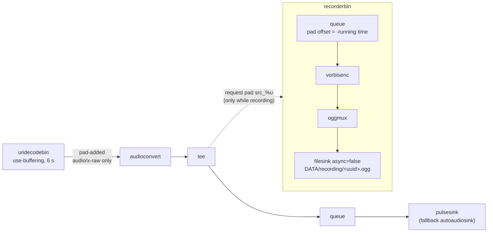
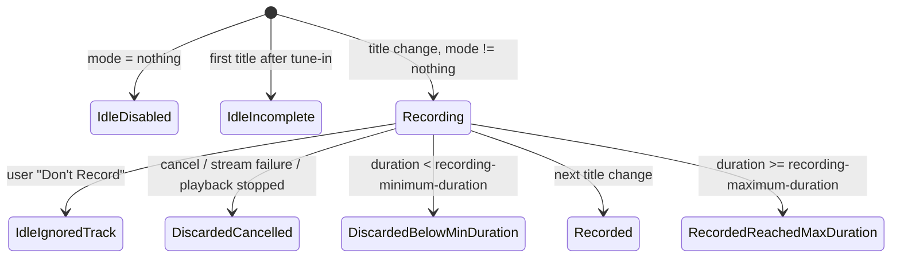

# 05 — Audio pipeline and recording

Line numbers are 1-based against the `windows-port` baseline.
Main file: [src/audio/gstreamer_backend.rs](../../src/audio/gstreamer_backend.rs) (`GstreamerBackend`),
driven by `SwPlayer` in [src/audio/player.rs](../../src/audio/player.rs).

## Pipeline graph

Built with `gst::parse::launch` in `GstreamerBackend::new()`
([gstreamer_backend.rs:81-121](../../src/audio/gstreamer_backend.rs#L81-L121)):

```text
uridecodebin name=uridecodebin use-buffering=true buffer-duration=6s
   ! audioconvert name=audioconvert
   ! tee name=tee
   ! queue
   ! {pulsesink | autoaudiosink} name={same}
```



- The sink is chosen by `check_pulse_support()`, which simply tries
  `ElementFactory::make("pulsesink")` ([gstreamer_backend.rs:504-507](../../src/audio/gstreamer_backend.rs#L504-L507)).
  Without PulseAudio it warns *"Cannot find PulseAudio. Shortwave will only work
  with limited functions."* and uses `autoaudiosink`.
- `uridecodebin` → `audioconvert` is linked dynamically in a `pad-added`
  handler that ignores non-`audio/x-raw` pads ([gstreamer_backend.rs:164-189](../../src/audio/gstreamer_backend.rs#L164-L189)).
- `pipeline.set_message_forward(true)` lets EOS from the recorder bin reach the
  bus as `GstBinForwarded` element messages.

## Volume

Volume and mute only work when an element **named `"pulsesink"`** exists:

- `volume()` / `set_volume()` / `set_mute()` look it up by name
  ([gstreamer_backend.rs:275-306](../../src/audio/gstreamer_backend.rs#L275-L306));
  otherwise `set_volume` logs *"PulseAudio is required for changing the volume."*
- `setup_signals()` mirrors external volume/mute changes (e.g. from
  pavucontrol) back to the UI via `notify::volume` / `notify::mute`
  ([gstreamer_backend.rs:124-162](../../src/audio/gstreamer_backend.rs#L124-L162)).
- Conversion: UI volume is **cubic**, sink volume is **linear**
  (`StreamVolume::convert_volume`).

**Windows impact:** with any non-Pulse sink, volume is silently stuck at 100 %.
`wasapi2sink` and `wasapisink` both expose `volume` and `mute` and implement
`GstStreamVolume`, so the fix is to look the sink up by a fixed name
(`name=audiosink`) instead of by factory name, not to change the logic.

## Bus messages → app state

`parse_bus_message()` ([gstreamer_backend.rs:509-632](../../src/audio/gstreamer_backend.rs#L509-L632))
turns bus messages into `GstreamerChange` values sent over a bounded
`async_channel` (capacity 10) to `SwPlayer::process_gst_message`
([player.rs:245-254](../../src/audio/player.rs#L245-L254)):

| Bus message | Handling | `GstreamerChange` |
|---|---|---|
| `Tag` with `Title` | de-duplicated against `current_title` | `Title(String)` |
| `StateChanged` (pipeline only, see GNOME issue #528) | Playing/Paused → Playing, Ready → Loading, else Stopped | `PlaybackState` |
| `Buffering` < 100 % | state Loading; for **non-live** streams block the tee sink pad with a probe and pause | `PlaybackState(Loading)` |
| `Buffering` = 100 % | resume + remove probe | `PlaybackState(Playing)` |
| `Element` `GstBinForwarded` wrapping `Eos` from recorderbin | `call_async` → `destroy_recorderbin` | — |
| `Error` | log; Failure | `PlaybackState(Failure)` + `Failure(msg)` |

Liveness is learnt on the first transition to ≥ Paused
(`NoPreroll` ⇒ live) in `set_state()` ([gstreamer_backend.rs:221-262](../../src/audio/gstreamer_backend.rs#L221-L262)).

## Title → track → recording

`SwPlayer::gst_title_change()` ([player.rs:256-301](../../src/audio/player.rs#L256-L301)):

1. Create `SwTrack::new(title, station)`; its temp file is
   `path::DATA/recording/<uuid>.ogg` ([src/audio/track.rs:79-83](../../src/audio/track.rs#L79-L83)).
2. `stop_recording(TrackChange)` on the previous track.
3. Move the previous track to `past_tracks` (an `SwTrackModel` capped at
   `playback-past-tracks-count`).
4. If `recording-mode != nothing`: start recording **only if there was a
   previous track** — the first title after tuning in is assumed incomplete
   (`IdleIncomplete`).
5. If `notifications` is on, send a `gio::Notification` with *Save Track* /
   *Don't Record* buttons ([player.rs:436-467](../../src/audio/player.rs#L436-L467)).

### Recorder bin

`start_recording()` ([gstreamer_backend.rs:318-374](../../src/audio/gstreamer_backend.rs#L318-L374)):
`queue ! vorbisenc ! oggmux ! filesink async=false`; the queue's src pad gets a
negative offset equal to the current running time so durations start at 0; the
bin is set to Playing *before* it's added, then linked to a new `tee` request
pad.

`stop_recording(discard)` ([gstreamer_backend.rs:376-444](../../src/audio/gstreamer_backend.rs#L376-L444)):
an IDLE probe on the tee pad unlinks and releases it; if keeping the data, EOS is
sent to the bin (finalising the Ogg file) and the bin is torn down when the
forwarded EOS arrives; if discarding, the bin is destroyed at once.

`recording_duration()` = `(bin running time − |offset|) / 1e9`
([gstreamer_backend.rs:450-478](../../src/audio/gstreamer_backend.rs#L450-L478)),
polled every second by a `timeout_add_seconds_local` in
`SwPlayer::constructed` that also enforces `recording-maximum-duration`
([player.rs:177-201](../../src/audio/player.rs#L177-L201)).

### State machine

`SwRecordingState` ([src/audio/recording_state.rs:22-41](../../src/audio/recording_state.rs#L22-L41)):



`SwPlayer::stop_recording()` ([player.rs:369-434](../../src/audio/player.rs#L369-L434))
picks the end state, then:

- saves immediately if `mode == everything` **or** the user pressed *Save* while
  recording (`save_when_recorded`);
- deletes the temp file when discarding.

`SwRecordingMode` = `Everything | Decide | Nothing`
([src/audio/recording_mode.rs:20-29](../../src/audio/recording_mode.rs#L20-L29)).

`SwTrack::save()` ([track.rs:177-198](../../src/audio/track.rs#L177-L198)) copies
the temp file to
`<recording-track-directory>/<sanitize_filename::sanitize(title)>.ogg`.
`sanitize-filename 0.6` defaults to `windows: cfg!(windows)`, so on Windows it
already strips `<>:"/\|?*`, control characters, trailing dots/spaces and the
reserved names (`CON`, `NUL`, `COM1`…), and truncates the *name* to 255 bytes.
It does **not** guard the total path length (MAX_PATH 260) — still a port task.
Two tracks with the same title overwrite each other (`fs::copy`) on every
platform.

## GStreamer elements needed at runtime

| Element | Plugin (`.dll` in `lib/gstreamer-1.0`) | MSYS2 package |
|---|---|---|
| `uridecodebin`, `decodebin`, `urisourcebin` | `gstplayback` | gst-plugins-base |
| `typefind` | `gsttypefindfunctions` | gst-plugins-base |
| `audioconvert` | `gstaudioconvert` | gst-plugins-base |
| `audioresample` (auto-plugged by sinks) | `gstaudioresample` | gst-plugins-base |
| `tee`, `queue`, `filesink`, `queue2` (buffering) | `gstcoreelements` | gstreamer |
| `vorbisenc`, `vorbisdec` | `gstvorbis` | gst-plugins-base |
| `oggmux`, `oggdemux` | `gstogg` | gst-plugins-base |
| `opusdec` | `gstopus` | gst-plugins-base |
| `souphttpsrc` (HTTP/HTTPS streams) | `gstsoup` (dlopens `libsoup-3.0-0.dll`) | gst-plugins-good + libsoup3 |
| `icydemux` (Shoutcast/Icecast metadata → `Title` tags) | `gsticydemux` | gst-plugins-good |
| `id3demux` | `gstid3demux` | gst-plugins-good |
| `mpegaudioparse`, `aacparse`, `flacparse` | `gstaudioparsers` | gst-plugins-good |
| `mpg123audiodec` (MP3) | `gstmpg123` | gst-plugins-good |
| `flacdec` | `gstflac` | gst-plugins-good |
| `hlsdemux2`, `dashdemux2` | `gstadaptivedemux2` | gst-plugins-good |
| `hlsdemux` (legacy) | `gsthls` | gst-plugins-bad |
| `tsdemux` (HLS MPEG-TS segments) | `gstmpegtsdemux` | gst-plugins-bad |
| `avdec_aac`, `avdec_mp3`… | `gstlibav` | gst-libav |
| **Linux:** `pulsesink` | `gstpulseaudio` | — (not used on Windows) |
| **Windows:** `wasapi2sink` → `wasapisink` → `autoaudiosink` | `gstwasapi2`, `gstwasapi`, `gstautodetect` | gst-plugins-bad, gst-plugins-bad, gst-plugins-good |

The bundle should ship these plugins plus their DLL closure, not all of
`lib/gstreamer-1.0` (Phase 5).

## Other audio-related Linux touchpoints

- `PULSE_PROP_application.icon_name` / `…metadata().name` env vars set in
  `main()` ([src/main.rs:64-65](../../src/main.rs#L64-L65)) — harmless no-ops on
  Windows; the second key is also mistyped upstream (`metadata().name`).
- Suspend inhibition while playing: `SwApplication::set_inhibit()` →
  `gtk::Application::inhibit(SUSPEND)` ([src/app.rs:342-360](../../src/app.rs#L342-L360)).
  GTK4's inhibit is implemented through D-Bus portals / session manager on
  Linux; on Windows it is expected to be a no-op (returns cookie 0) — to be
  confirmed at runtime, with `SetThreadExecutionState(ES_SYSTEM_REQUIRED)` as the
  replacement.
